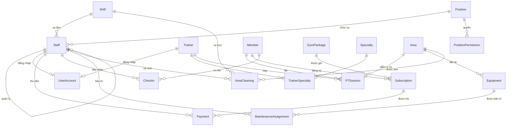

# Thiết kế cơ sở dữ liệu BCNF – Quản lý Phòng Gym

- **DBMS:** SQL Server 2022 (instance mặc định `localhost:1433`), database `GymManagementDB`
- **Script:** `database/01_schema.sql`, `02_seed.sql`, `03_app_login.sql`, `04_upgrade_roles.sql` (nâng cấp database bản cũ, giữ dữ liệu), chạy qua `setup_database.ps1`

## 1. Phân tích chức năng từ UI

| Màn hình | Thao tác | Dữ liệu cần lưu | Bảng |
|---|---|---|---|
| Đăng nhập | Xác thực, đổi mật khẩu, đăng xuất | Tài khoản của nhân viên/HLV, quyền theo chức vụ | `UserAccount`, `Position`, `PositionPermission` |
| Tài khoản | Tạo, đặt lại mật khẩu, xóa, tìm | Tài khoản của từng người | `UserAccount` |
| Dashboard | 5 KPI, doanh thu 6 tháng, check-in gần nhất | Tổng hợp, không lưu riêng | Truy vấn trên `Member`, `Subscription`, `GymPackage`, `Checkin`, `Payment` |
| Hội viên | Thêm, sửa, xóa, tìm | Thông tin cá nhân | `Member` |
| Gói tập | Thêm, sửa, xóa, tìm | Giá, thời lượng, mô tả | `GymPackage` |
| Đăng ký gói | Thêm, sửa, xóa, lọc trạng thái | Hội viên – gói – thời hạn | `Subscription` |
| Thanh toán | Lập, xóa, lọc phương thức | Hóa đơn của một đăng ký | `Payment` |
| Check-in | Check-in, check-out, xóa, tìm | Lượt ra vào | `Checkin` |
| HLV | Thêm, sửa, xóa, tìm | Hồ sơ, nhiều chuyên môn | `Trainer`, `Specialty`, `TrainerSpecialty` |
| Lịch PT | Thêm, sửa, xóa, lọc trạng thái | Buổi tập của HLV với hội viên | `PTSession` |
| Nhân viên | Thêm, sửa, xóa, tìm | Hồ sơ, ca, quản lý, chức vụ | `Staff`, `Shift`, `Position` |
| Khu vực | Thêm, sửa, xóa, tìm | Tên, tầng | `Area` |
| Thiết bị | Thêm, sửa, xóa, lọc trạng thái | Giá trị, vị trí | `Equipment` |
| Bảo trì | Phân công, cập nhật, xóa, tìm | Ai bảo trì máy nào, ngày nào | `MaintenanceAssignment` |
| Vệ sinh | Phân công, cập nhật, xóa, tìm | Ai dọn khu nào, ca nào | `AreaCleaning` |

## 2. Lỗi chuẩn hóa trong model cũ và cách xử lý

| Vấn đề trong model cũ | Vi phạm | Xử lý |
|---|---|---|
| `Staff.shift = "Ca sáng (06:00 - 14:00)"`, gộp tên ca và giờ | 1NF (không nguyên tố); `ShiftName → StartTime, EndTime` là phụ thuộc bắc cầu qua khóa | Tách bảng `Shift`; `Staff` chỉ giữ `ShiftID` |
| `AreaCleaning.shift = "Ca sáng"` là chuỗi khác cho cùng khái niệm ca | Dữ liệu không nhất quán | Dùng chung `Shift` |
| `Trainer.specialty = "Giảm mỡ, Pilates & Yoga"` | 1NF (đa trị) | Tách `Specialty` và `TrainerSpecialty` (N-N) |
| `Trainer.experience = "6 năm"` | Số lẫn đơn vị | `ExperienceYears INT` |
| `Staff.managerId = "None"`, `Checkin.checkoutTime = "--:--"` | Giá trị giả thay cho NULL, phá FK và kiểu dữ liệu | Dùng `NULL` |
| Ngày giờ và tiền lưu bằng `String`/`double` | Sai miền giá trị, sai số làm tròn | `DATE`, `DATETIME2(0)`, `DECIMAL(15,2)` |
| Mật khẩu hard-code trong `LoginController` | Không có nơi lưu tài khoản | `UserAccount`, băm PBKDF2 có salt |
| `MaintenanceAssignment`, `AreaCleaning` không có khóa; khóa (Staff, Equipment/Area) không cho phân công lặp lại | Không xác định được bộ | Khóa tổ hợp có ngày (mục 3) |

## 3. Phụ thuộc hàm và kiểm tra BCNF

Một quan hệ đạt BCNF khi vế trái của **mọi** phụ thuộc hàm không tầm thường đều là siêu khóa. Dưới đây là toàn bộ định thức của từng bảng; vế trái nào cũng là khóa dự tuyển, nên cả 18 bảng đều đạt BCNF.

| Bảng | Phụ thuộc hàm (định thức → phần còn lại) | Khóa dự tuyển |
|---|---|---|
| `Shift` | ShiftID → ShiftName, StartTime, EndTime; ShiftName → ShiftID, StartTime, EndTime | ShiftID, ShiftName |
| `Staff` | StaffID → mọi cột; Phone → mọi cột | StaffID, Phone |
| `Position` | PositionID ↔ PositionName | Cả hai |
| `PositionPermission` | {PositionID, ScreenCode} → AccessLevel | Khóa tổ hợp |
| `UserAccount` | Username → mọi cột; StaffID → mọi cột (khi có); TrainerID → mọi cột (khi có) | Username, StaffID, TrainerID |
| `Member` | MemberID → mọi cột; Phone → mọi cột; Email → mọi cột (khi có) | MemberID, Phone, Email |
| `GymPackage` | PackageID → mọi cột; PackageName → mọi cột | PackageID, PackageName |
| `Subscription` | SubscriptionID → mọi cột; {MemberID, PackageID, StartDate} → mọi cột | Cả hai |
| `Payment` | PaymentID → mọi cột | PaymentID |
| `Checkin` | CheckinID → mọi cột; {MemberID, CheckinTime} → mọi cột | Cả hai |
| `Trainer` | TrainerID → mọi cột; Phone → mọi cột | TrainerID, Phone |
| `Specialty` | SpecialtyID ↔ SpecialtyName | Cả hai |
| `TrainerSpecialty` | Không có PTH không tầm thường | {TrainerID, SpecialtyID} |
| `Area` | AreaID → mọi cột; AreaName → mọi cột | AreaID, AreaName |
| `PTSession` | SessionID → mọi cột; {TrainerID, StartTime} → mọi cột; {MemberID, StartTime} → mọi cột | Cả ba |
| `Equipment` | EquipmentID → mọi cột | EquipmentID |
| `MaintenanceAssignment` | {StaffID, EquipmentID, MaintenanceDate} → Note, Status | Khóa tổ hợp |
| `AreaCleaning` | {AreaID, CleaningDate, ShiftID} → StaffID, Status | Khóa tổ hợp |

### Các trường hợp dễ bị coi là vi phạm

- **`Subscription.EndDate`:** nhìn như {StartDate, PackageID} → EndDate. PTH này **không tồn tại**: form cho sửa `EndDate` (gia hạn, bù ngày tạm dừng), và `DurationDays` của gói đổi về sau không được làm đổi hạn của hợp đồng đã ký. `DurationDays` chỉ dùng để gợi ý ngày kết thúc khi đăng ký mới.
- **`Payment.Amount`:** không phụ thuộc `GymPackage.Price`, vì hóa đơn ghi số tiền thực thu (giảm giá, trả nhiều lần) và không đổi khi giá gói đổi.
- **`Payment` không chứa `MemberID`:** suy ra được qua `SubscriptionID → MemberID`, thêm vào sẽ tạo phụ thuộc bắc cầu.
- **`Subscription.Status`:** "Đang hoạt động/Hết hạn" phụ thuộc ngày hiện tại chứ không phụ thuộc thuộc tính nào khác, và "Tạm dừng" là dữ kiện độc lập, nên không phải PTH trong quan hệ. Ứng dụng tự chuyển đăng ký quá hạn sang "Hết hạn" khi tải danh sách.
- **`Equipment.Status` và `MaintenanceAssignment.Status`:** hai dữ kiện khác nhau (tình trạng máy và tiến độ một phiếu bảo trì). Máy có thể "Tốt" trong khi phiếu cũ đã hoàn thành.
- **`AreaCleaning`:** {StaffID, CleaningDate, ShiftID} không xác định AreaID, vì một người dọn nhiều khu trong cùng ca (dữ liệu mẫu: ST005 dọn AR01 và AR02 ca sáng). Vì vậy không có định thức phụ trái BCNF.
- **`UserAccount` không có cột chức vụ:** StaffID → PositionID đã có ở `Staff`, thêm vào sẽ tạo phụ thuộc bắc cầu. Nhờ vậy đổi chức vụ của nhân viên là quyền đổi theo ở lần đăng nhập sau.
- **Danh mục trạng thái:** các tập giá trị cố định (`Status`, `PaymentMethod`, `Gender`) dùng `CHECK`. Lặp một chuỗi không phải PTH nên không ảnh hưởng BCNF; không có thuộc tính nào khác phụ thuộc vào chúng, khác với `Shift`.

## 4. Sơ đồ quan hệ

## 5. Quy tắc nghiệp vụ trong database

- **Xóa:** khóa ngoại chặn xóa khi còn dữ liệu con (ví dụ hội viên đã có đăng ký); ngoại lệ là `TrainerSpecialty` và `UserAccount` tự xóa theo HLV/nhân viên. Ứng dụng báo lỗi tiếng Việt thay vì để lại dữ liệu mồ côi như bản in-memory.
- **Trùng lặp:** điện thoại, email, tên gói, tên khu vực là duy nhất; một HLV không thể có hai buổi bắt đầu cùng lúc.
- **Miền giá trị:** tiền không âm, thanh toán > 0, ngày/giờ kết thúc không trước bắt đầu.

## 6. Phân quyền

Quyền nằm trong bảng `PositionPermission`, sửa bảng này là đổi được quyền mà không cần sửa code. Người dùng lấy quyền theo chức vụ: nhân viên theo `Staff.PositionID`, HLV luôn là `HLV`.

- **Quản lý** – toàn quyền: có quyền `MANAGE` trên cả 14 màn hình.
- **`MANAGE`** – thêm, sửa, xóa. **`VIEW`** – chỉ xem. **`OWN`** – chỉ thấy việc của mình và chỉ cập nhật trạng thái/ghi chú. Không có dòng – không thấy màn hình và không tải dữ liệu.

| Màn hình | Lễ tân | Kỹ thuật viên | Tạp vụ | Huấn luyện viên |
|---|---|---|---|---|
| Hội viên, Đăng ký, Thanh toán, Check-in | MANAGE | | | |
| Gói tập, HLV | VIEW | | | |
| Lịch PT | MANAGE | | | OWN |
| Khu vực | VIEW | VIEW | VIEW | VIEW |
| Thiết bị | | MANAGE | | |
| Bảo trì | | OWN | | |
| Vệ sinh | | | OWN | |
| Dashboard, Nhân viên, Tài khoản | | | | |

**Tài khoản:** Quản lý tạo tài khoản với mật khẩu tạm; người dùng phải đổi ở lần đăng nhập đầu và sau mỗi lần đặt lại. Ô "Lễ tân" chỉ liệt kê chức vụ Lễ tân, ô phân công bảo trì chỉ liệt kê Kỹ thuật viên, ô phân công vệ sinh chỉ liệt kê Tạp vụ.

## 7. Giới hạn đã biết

- Phân quyền được kiểm soát trong ứng dụng. Mọi người dùng chung login SQL `gym_app`, nên ai có `db.properties` và công cụ SQL thì đi vòng qua được. Chỉ cài ứng dụng trên máy tin cậy; muốn chặn ở tầng database phải có lớp API riêng hoặc login SQL riêng theo vai trò.
- Ràng buộc "người thu tiền phải là Lễ tân" chỉ áp dụng khi chọn trên form, không có ràng buộc ở database, và không kiểm tra lại với dữ liệu cũ khi nhân viên đổi chức vụ.
- Khóa của phiếu bảo trì và phân công vệ sinh không sửa được; muốn đổi thiết bị, ngày hay ca thì xóa rồi tạo lại.
