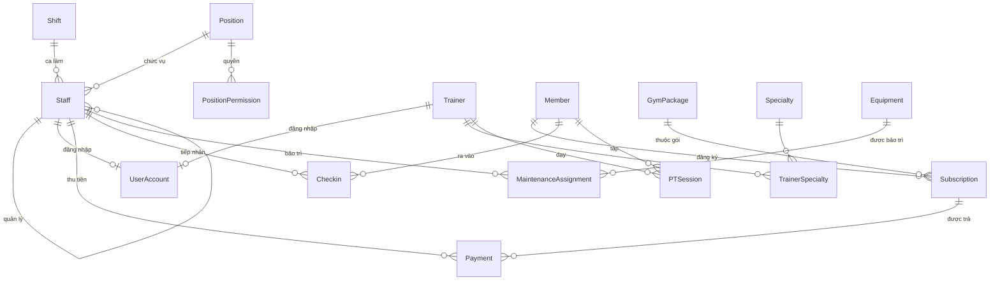

# Thiết kế cơ sở dữ liệu – Quản lý Phòng Gym

- Hệ quản trị: SQL Server 2022, database `GymManagementDB`
- Script nằm trong thư mục `database/`: `01_schema.sql` (tạo bảng), `02_seed.sql` (dữ liệu mẫu), `03_app_login.sql` (login cho ứng dụng), `04_upgrade_roles.sql` và `05_equipment_status.sql` (nâng cấp database cũ)

## 1. Các bảng và chức năng

Nhóm em xem từng màn hình của ứng dụng rồi xác định cần lưu những gì. Kết quả là 16 bảng:

| Màn hình | Bảng dùng |
|---|---|
| Đăng nhập, Tài khoản | `UserAccount`, `Position`, `PositionPermission` |
| Dashboard | Không có bảng riêng, chỉ tính từ `Member`, `Subscription`, `Checkin`, `Payment` |
| Hội viên | `Member` |
| Gói tập | `GymPackage` |
| Đăng ký gói | `Subscription` |
| Thanh toán | `Payment` |
| Check-in | `Checkin` |
| Huấn luyện viên | `Trainer`, `Specialty`, `TrainerSpecialty` |
| Lịch PT | `PTSession` |
| Nhân viên | `Staff`, `Shift`, `Position` |
| Thiết bị | `Equipment` |
| Bảo trì | `MaintenanceAssignment` |

## 2. Những lỗi của model cũ và cách sửa

Lúc đầu dữ liệu chỉ lưu trong bộ nhớ (List trong Java) nên có nhiều chỗ chưa chuẩn. Khi chuyển sang database nhóm em sửa như sau:

| Lỗi ở model cũ | Vì sao sai | Cách sửa |
|---|---|---|
| `Staff.shift = "Ca sáng (06:00 - 14:00)"` | Gộp tên ca và giờ vào một ô, vi phạm 1NF. Ngoài ra tên ca quyết định giờ làm nên bị phụ thuộc bắc cầu | Tách bảng `Shift`, `Staff` chỉ giữ `ShiftID` |
| `Trainer.specialty = "Giảm mỡ, Yoga"` | Một ô chứa nhiều giá trị (vi phạm 1NF) | Tách `Specialty` và `TrainerSpecialty` (quan hệ N-N) |
| `Trainer.experience = "6 năm"` | Số lẫn với chữ | Đổi thành `ExperienceYears INT` |
| `managerId = "None"`, `checkoutTime = "--:--"` | Dùng chuỗi giả thay cho NULL nên không đặt khóa ngoại được | Dùng `NULL` |
| Ngày và tiền lưu bằng `String`, `double` | Sai kiểu, tiền dễ bị sai số | Dùng `DATE`, `DATETIME2`, `DECIMAL(15,2)` |
| Mật khẩu viết cứng trong `LoginController` | Không có chỗ lưu tài khoản | Thêm bảng `UserAccount`, mật khẩu băm PBKDF2 có salt |
| Bảo trì chưa có khóa chính | Không phân biệt được các lần bảo trì | Khóa tổ hợp (StaffID, EquipmentID, MaintenanceDate) |

## 3. Kiểm tra dạng chuẩn BCNF

Một bảng đạt BCNF khi vế trái của mọi phụ thuộc hàm không tầm thường đều là siêu khóa. Nhóm em liệt kê các phụ thuộc hàm của từng bảng, vế trái nào cũng là khóa nên 16 bảng đều đạt BCNF.

| Bảng | Phụ thuộc hàm | Khóa |
|---|---|---|
| `Shift` | ShiftID → ShiftName, StartTime, EndTime; ShiftName → ShiftID, ... | ShiftID, ShiftName |
| `Staff` | StaffID → các cột còn lại; Phone → các cột còn lại | StaffID, Phone |
| `Position` | PositionID ↔ PositionName | PositionID, PositionName |
| `PositionPermission` | {PositionID, ScreenCode} → AccessLevel | {PositionID, ScreenCode} |
| `UserAccount` | Username → các cột còn lại (StaffID, TrainerID cũng là khóa vì mỗi người chỉ có một tài khoản) | Username, StaffID, TrainerID |
| `Member` | MemberID → các cột còn lại; Phone → ...; Email → ... | MemberID, Phone, Email |
| `GymPackage` | PackageID ↔ PackageName, các cột còn lại phụ thuộc vào cả hai | PackageID, PackageName |
| `Subscription` | SubscriptionID → ...; {MemberID, PackageID, StartDate} → ... | cả hai |
| `Payment` | PaymentID → các cột còn lại | PaymentID |
| `Checkin` | CheckinID → ...; {MemberID, CheckinTime} → ... | cả hai |
| `Trainer` | TrainerID → ...; Phone → ... | TrainerID, Phone |
| `Specialty` | SpecialtyID ↔ SpecialtyName | cả hai |
| `TrainerSpecialty` | Không có phụ thuộc hàm không tầm thường | {TrainerID, SpecialtyID} |
| `PTSession` | SessionID → ...; {TrainerID, StartTime} → ...; {MemberID, StartTime} → ... | cả ba |
| `Equipment` | EquipmentID → các cột còn lại | EquipmentID |
| `MaintenanceAssignment` | {StaffID, EquipmentID, MaintenanceDate} → Note, Status | khóa tổ hợp |

### Một số chỗ nhìn giống vi phạm nhưng thực ra không

- **`Subscription.EndDate`**: nhìn thì tưởng {StartDate, PackageID} → EndDate. Nhưng ứng dụng cho sửa `EndDate` (gia hạn, bù ngày tạm dừng), và nếu sau này gói đổi `DurationDays` thì hợp đồng cũ vẫn giữ nguyên. Vì vậy không có phụ thuộc hàm này. `DurationDays` chỉ dùng để gợi ý ngày kết thúc khi đăng ký mới.
- **`Payment.Amount`**: không phụ thuộc vào `GymPackage.Price` vì hóa đơn ghi số tiền thực thu (có thể giảm giá hoặc trả làm nhiều lần).
- **`Payment` không có `MemberID`**: có thể suy ra từ `SubscriptionID`. Nếu thêm vào sẽ bị phụ thuộc bắc cầu.
- **`Subscription.Status`**: trạng thái "Hết hạn" phụ thuộc vào ngày hiện tại chứ không phụ thuộc cột nào trong bảng, nên không tạo phụ thuộc hàm. Ứng dụng tự chuyển sang "Hết hạn" khi tải danh sách.
- **`Equipment.Status` và `MaintenanceAssignment.Status`**: hai cái khác nhau (tình trạng của máy và tiến độ của phiếu bảo trì), nên giữ ở hai bảng.
- **`UserAccount` không có cột chức vụ**: chức vụ đã nằm ở `Staff.PositionID`, nếu thêm vào sẽ bị phụ thuộc bắc cầu. Đổi chức vụ thì lần đăng nhập sau tự đổi quyền.
- **Các cột trạng thái, phương thức thanh toán, giới tính**: dùng `CHECK` để giới hạn giá trị, không tách bảng riêng vì không có thuộc tính nào phụ thuộc vào chúng.

## 4. Sơ đồ quan hệ

## 5. Quy tắc trong database

- **Xóa**: khóa ngoại chặn xóa khi còn dữ liệu con (ví dụ hội viên đã có đăng ký thì không xóa được). Riêng `TrainerSpecialty` và `UserAccount` tự xóa theo huấn luyện viên/nhân viên.
- **Không trùng**: số điện thoại, email, tên gói, tên ca, tên chuyên môn là duy nhất. Một huấn luyện viên không có hai buổi bắt đầu cùng lúc.
- **Miền giá trị**: tiền không âm, số tiền thanh toán lớn hơn 0, giờ kết thúc không trước giờ bắt đầu.

## 6. Phân quyền

Quyền lưu trong bảng `PositionPermission`, muốn đổi quyền chỉ cần sửa bảng này, không phải sửa code. Nhân viên lấy quyền theo `Staff.PositionID`, huấn luyện viên luôn có chức vụ `HLV`.

- `MANAGE`: thêm, sửa, xóa. `VIEW`: chỉ xem. `OWN`: chỉ thấy việc của mình và chỉ cập nhật trạng thái/ghi chú. Không có dòng nào thì không thấy màn hình đó.
- Quản lý có `MANAGE` ở tất cả màn hình.

| Màn hình | Lễ tân |
|---|---|
| Hội viên, Đăng ký, Thanh toán, Check in / Check out | MANAGE |
| Huấn luyện viên | VIEW |
| Lịch PT | MANAGE |
| Gói tập, Thiết bị, Bảo trì, Nhân viên, Dashboard | (không có, chỉ Quản lý) |

Chỉ có hai chức vụ đăng nhập được là Quản lý và Lễ tân. Các chức vụ khác (kỹ thuật viên, tạp vụ, huấn luyện viên) chỉ là hồ sơ nhân sự, không có tài khoản.

Quản lý tạo tài khoản với mật khẩu tạm, người dùng phải đổi mật khẩu ở lần đăng nhập đầu tiên.

## 7. Hạn chế

- Phân quyền chỉ kiểm tra trong ứng dụng. Mọi người dùng chung login SQL `gym_app`, nên ai có file `db.properties` và công cụ SQL thì vẫn vào thẳng database được. Vì vậy chỉ nên cài ứng dụng trên máy tin cậy.
- Ràng buộc "người thu tiền phải là Lễ tân" chỉ kiểm tra ở form, database không chặn. Nếu sau đó nhân viên đổi chức vụ thì dữ liệu cũ cũng không được kiểm tra lại.
- Khóa của phiếu bảo trì không sửa được. Muốn đổi thiết bị hoặc ngày thì phải xóa rồi tạo lại.
